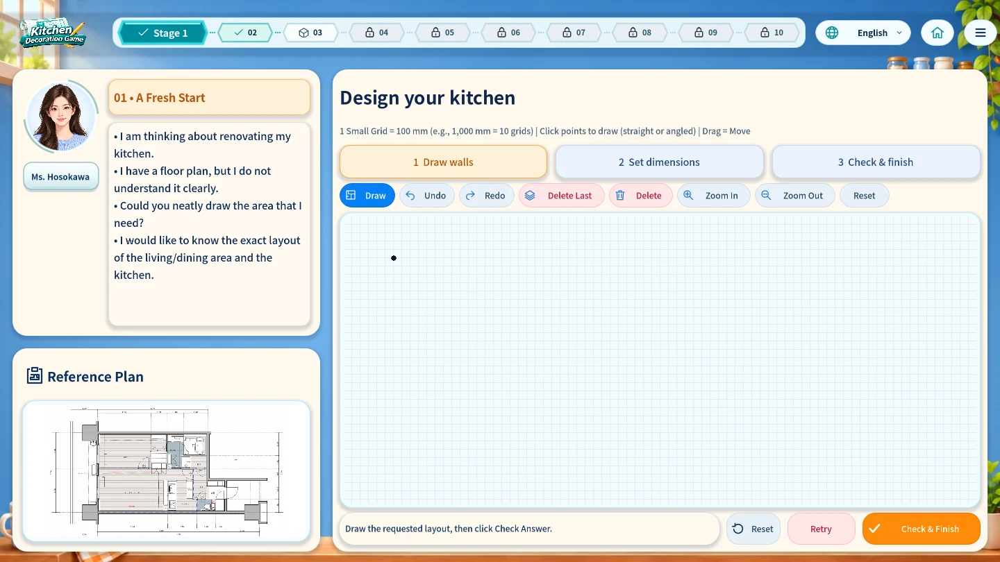

# Stage 1 kitchen UI preview

This experimental branch changes Stage 1 presentation only. The generated blue kitchen backdrop, ivory cards, blue drawing walls and orange Check & Finish action follow the design reference. The actual customer, reference plan, dimensions, recorded dialogue and grading rules are preserved rather than replaced with the mockup's example room.

To try: download or check out `preview/stage1-kitchen-quest`, open `project.godot` in Godot, and launch Stage 1 from the menu. The main branch and live Pages site remain unchanged. The existing deployment workflow deploys main only, so this branch is a local Godot preview.

Backup: `backup/before-stage1-kitchen-quest-2026-11-16` points to the original commit `46e7f33e9810ea1079f0276d08594666c0158a82`. Discard the preview branch to keep the original, or check out the backup branch to restore that exact version.

Only Main.gd, Stage1Assets additions and Stage 1 UI assertions in the trilingual smoke test are changed. Shared UI, stages 2 and 3, progress and drawing rules are unchanged. QuestDrawingCanvas inherits the existing drawing engine and overrides rendering only.
